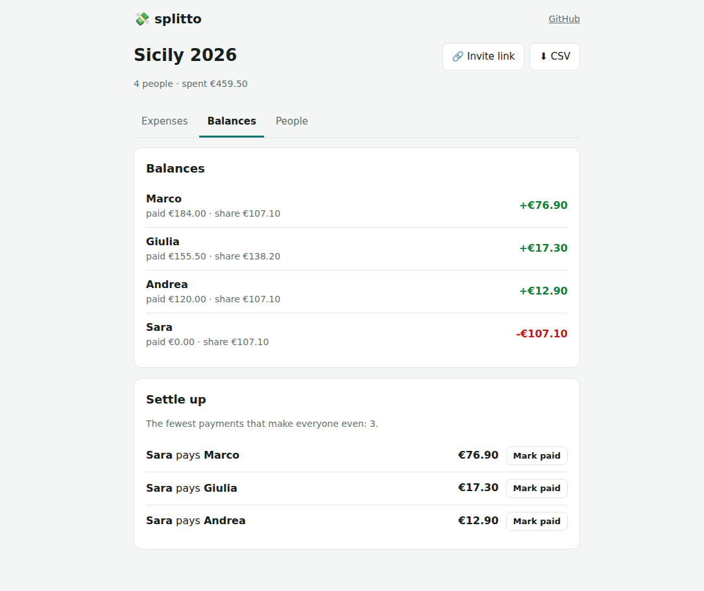
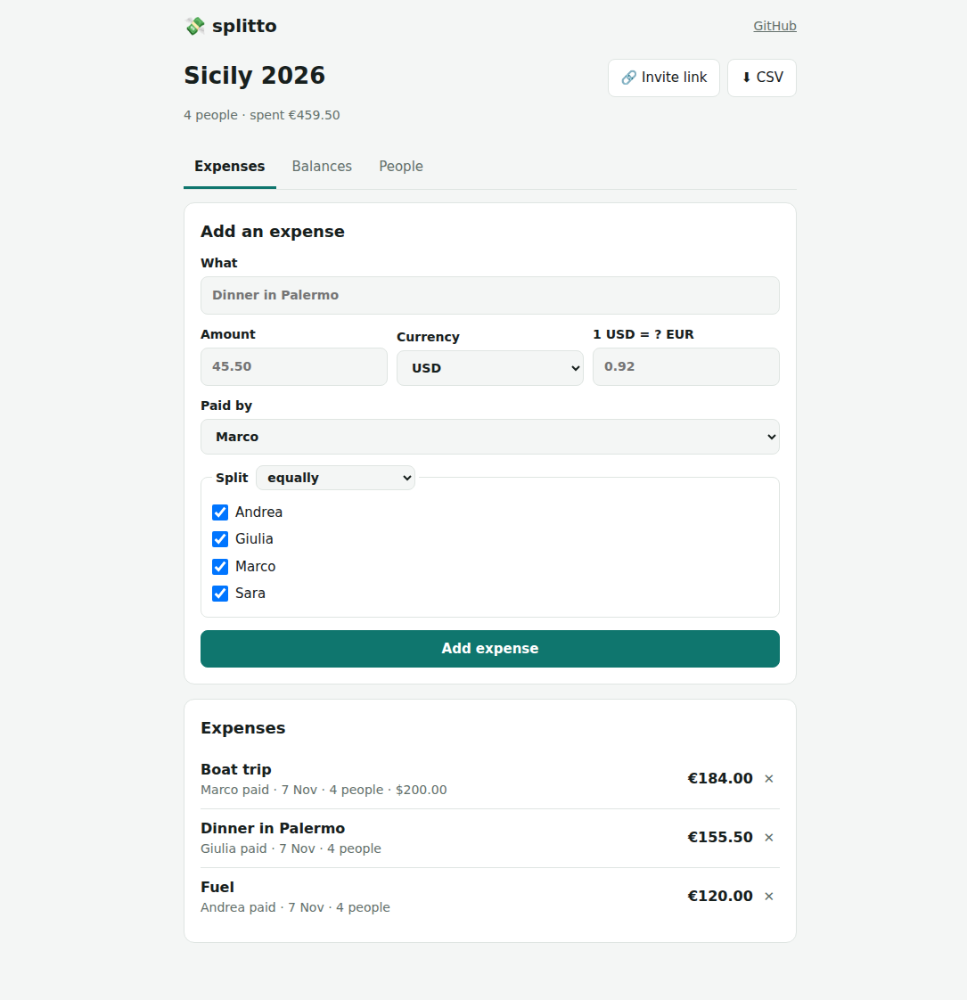
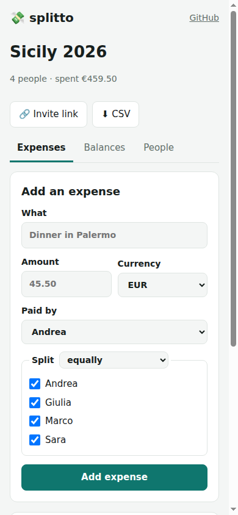

<div align="center">

# 💸 splitto

**Split group expenses and settle up with the fewest possible payments.**

Trips, dinners, flatmates. No sign-up: create a group, share the link, add who paid what. splitto works out who
owes whom, in any currency, to the cent, and finds the smallest number of bank transfers that makes everyone even.

[](https://github.com/AndreaAcanfora/splitto/actions/workflows/ci.yml)
[](Directory.Build.props)
[](src/Splitto.Api/Data)
[](LICENSE)
[](https://www.paypal.com/paypalme/AndreaAca)



</div>

## Features

- **No accounts.** A group is reached through a secret link (128 random bits). Share it in the group chat and
  everyone can add expenses. Groups can't be listed or guessed.
- **Split any way:** equally, by shares (a couple counts as two), or by exact amounts. Always to the cent: €10 among
  three is €3.34 + €3.33 + €3.33, never €9.99.
- **Any currency.** Pay in dollars on a trip in euros: enter the rate once and it's remembered for the next expense.
- **The fewest payments.** Not just "who owes what", but the shortest list of transfers to settle, and a button to
  mark each one paid.
- **Your data is yours:** CSV export with one column per person, ready for a spreadsheet.
- **Works on phones**, light and dark theme.

| Expenses | On a phone |
| --- | --- |
|  |  |

## The algorithm: fewest payments to settle

After the trip each person has a balance: positive if they're owed money, negative if they owe. The question is the
smallest number of payments that brings everyone to zero.

The naive answer, the largest debtor pays the largest creditor and repeat, is good but not optimal. With balances
**+4, +3, −2, −2, −3** it needs 4 payments, while 3 are enough: the person at −3 pays the one at +3, and the two at
−2 pay the one at +4.

The key observation: any group of people whose balances add up to zero can settle **among themselves** with
(size − 1) payments. So the fewest payments overall is **n − k**, where k is the largest number of zero-sum groups
the people can be split into. Finding k is NP-hard (it contains subset sum), but for real groups it's fast with
dynamic programming over subsets ([`Settlement.cs`](src/Splitto.Core/Settlement.cs)):

```text
dp[mask] = the most zero-sum groups that can be closed while adding the people in mask one at a time
dp[mask] = max over i in mask of dp[mask without i], plus 1 if the balances in mask sum to zero
```

That is O(2ⁿ · n): instant up to 20 people with an open balance (a million states). Above that, splitto falls back to
the greedy, which still needs at most n − 1 payments. The tests check the result against a brute-force search on 400
random groups: the number of payments is always the true minimum, and the payments always settle everyone exactly.

## Architecture

```text
src/Splitto.Core   the domain, no dependencies: money in cents, splits, settlement algorithm, API contracts
src/Splitto.Api    ASP.NET Core minimal APIs + EF Core on PostgreSQL; also serves the web client
src/Splitto.Web    Blazor WebAssembly: C# running in the browser, sharing Splitto.Core with the server
tests/             xUnit: domain tests, and API tests against a real PostgreSQL
```

- **Money is never a float.** Amounts are whole cents (`long`); proportional splits use integer arithmetic with
  the largest-remainder method, so the parts always add up to the total.
- **The database enforces the rules too.** Check constraints (amounts > 0, nobody pays themselves), unique
  invite tokens and unique names per group. A test bypasses the API and confirms PostgreSQL rejects bad rows.
- **Balances in SQL.** Paid, owed, sent and received per person are `GROUP BY` queries; only the settlement
  runs in memory.
- **Shared code.** The Blazor client and the API use the same request and response types from `Splitto.Core`.
- **Abuse limits.** Creating groups is rate limited per address (20 every 10 minutes).

### API

| Method | Path | |
| --- | --- | --- |
| `POST` | `/api/groups` | create a group: name, currency, people |
| `GET` | `/api/groups/{token}` | the group and its people |
| `POST` | `/api/groups/{token}/members` | add a person |
| `GET` `POST` | `/api/groups/{token}/expenses` | list or add expenses |
| `DELETE` | `/api/groups/{token}/expenses/{id}` | delete an expense |
| `GET` `POST` | `/api/groups/{token}/payments` | list or record payments between people |
| `DELETE` | `/api/groups/{token}/payments/{id}` | undo a payment |
| `GET` | `/api/groups/{token}/balances` | balances and the fewest payments to settle |
| `GET` | `/api/groups/{token}/export.csv` | everything as CSV |

Errors are [RFC 9457 problem details](https://www.rfc-editor.org/rfc/rfc9457) with a message meant for people:
`"The amounts add up to 9.00, not 10.00."`

## Run it

With Docker:

```bash
docker compose up        # app + PostgreSQL, then open http://localhost:8080
```

Or with the .NET 10 SDK and a PostgreSQL server:

```bash
export ConnectionStrings__Splitto="Host=localhost;Username=postgres;Password=postgres;Database=splitto"
dotnet run --project src/Splitto.Api      # applies the migrations on start
```

## Tests

```bash
export SPLITTO_TEST_DB="Host=localhost;Username=postgres;Password=postgres"   # a server to create test databases on
dotnet test
```

25 tests. The domain tests cover splits and rounding, currency conversion, and the settlement algorithm against a
brute-force optimum. The API tests start the real app with `WebApplicationFactory` on a fresh PostgreSQL database
per test class: a trip from the first expense to everyone settled, deleting expenses, validation messages, links
that only open their own group, database constraints, the CSV export and the rate limit. CI runs them against
PostgreSQL, checks that the EF Core migrations match the model, and starts the Docker image to smoke-test the
public API.

## Roadmap

- [ ] Edit expenses (today: delete and add again)
- [ ] Recurring expenses (rent, subscriptions)
- [ ] Receipt photos
- [ ] Exchange rates fetched automatically for the expense date
- [ ] Optional accounts to see all your groups across devices

## Support

splitto is free and open source. If it saved a friendship after a holiday, you can
[buy me a coffee on PayPal](https://www.paypal.com/paypalme/AndreaAca). Thank you!

## License

[MIT](LICENSE) © Andrea Acanfora
